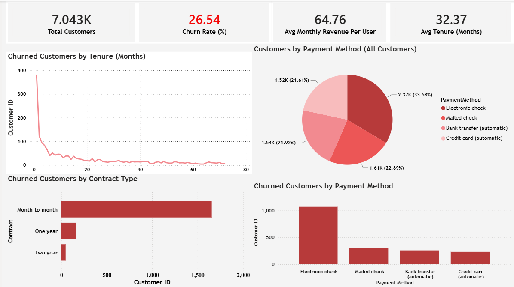
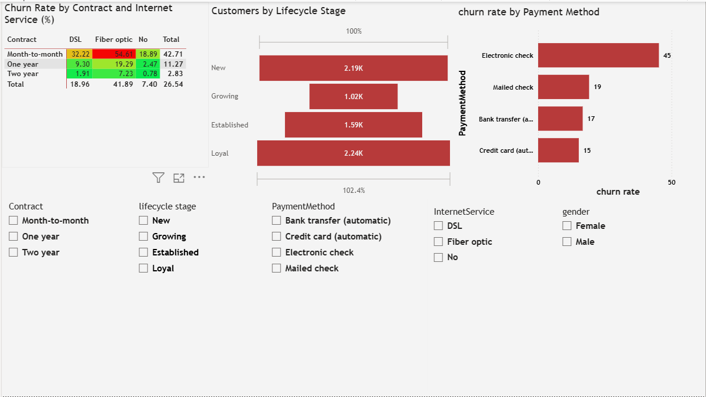
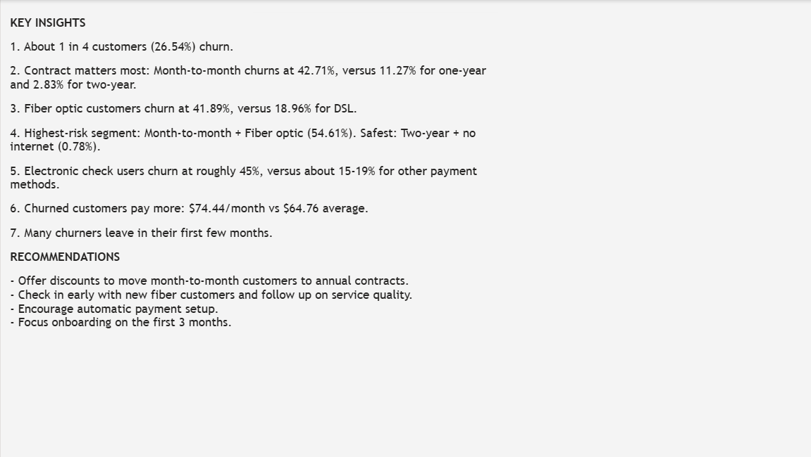

# Customer Churn Analysis

An end-to-end analytics project that explores why telecom customers leave, using **Excel, MySQL, and Power BI**.

## Project Goal

Identify which customers are most likely to churn and which factors are linked to it, so a business can focus its retention efforts where they matter most.

## Dataset

- **Source:** IBM Telco Customer Churn dataset (Kaggle)
- **Size:** 7,043 customers, 21 columns
- **Key fields:** tenure, contract type, internet service, payment method, monthly charges, total charges, churn (Yes/No)

## Tools Used

| Tool | Purpose |
|---|---|
| Excel | Data cleaning and initial KPI checks |
| MySQL | SQL analysis and cross-checking results |
| Power BI | Interactive dashboard (3 pages) |

## Process

1. **Data cleaning (Excel and SQL)**
   - Found 11 hidden blank values in `TotalCharges` (all new customers with tenure = 0) and set them to 0
   - Converted `TotalCharges` from text to a numeric type
   - Checked for duplicate customer IDs (none found)
   - Checked categories and data types for consistency
2. **KPIs** - total customers, churn rate, average monthly revenue per user, average tenure, calculated in Excel and verified in Power BI
3. **SQL analysis** - churn by contract type, churn by internet service, average monthly charges of churned customers, longest-tenure customers
4. **Dashboard** - KPI cards, churn charts, a contract x internet service heatmap, a lifecycle funnel, and 5 interactive slicers synced across pages

## Key KPIs

| KPI | Value |
|---|---|
| Total customers | 7,043 |
| Churned customers | 1,869 |
| Churn rate | 26.54% |
| Avg monthly revenue per user | $64.76 |
| Avg tenure | 32.37 months |

## Key Findings

1. **About 1 in 4 customers churn** (26.54%).
2. **Contract type matters most.** Month-to-month customers churn at 42.71%, versus 11.27% for one-year and 2.83% for two-year contracts.
3. **Fiber optic customers churn more:** 41.89%, versus 18.96% for DSL and 7.40% for customers with no internet.
4. **Highest-risk segment:** Month-to-month + Fiber optic (54.61% churn). The safest segment, two-year + no internet, churns at 0.78%.
5. **Payment method:** Electronic check users churn at roughly 45%, versus about 15-19% for the other payment methods.
6. **Churned customers pay more:** $74.44 per month on average, versus $64.76 across all customers.
7. **Many churners leave early,** within their first few months.

## Recommendations

- Offer discounts to move month-to-month customers onto annual contracts.
- Check in early with new fiber customers and follow up on service quality.
- Encourage automatic payment setup.
- Focus onboarding on the first 3 months.

## Limitations

- The dataset is a **snapshot**, not a timeline. It has no signup or churn dates, so a true monthly churn trend is not possible. Tenure was used instead to show *when in a customer's lifetime* churn happens.
- The findings show **associations, not causes.** Recommendations about service quality and payment behavior are ideas to test, not proven fixes.

## Dashboard Preview

**Overview**





**Segment Analysis**





**Key Insights**





## Project Structure

```
Customer-Churn-Analysis/
|
|-- Dataset/
|-- SQL Queries/
|-- PowerBI Dashboard/
|-- Screenshots/
|-- README.md
```

## Possible Next Steps

- Build a churn prediction model in Python (Logistic Regression, Random Forest)
- Rank the factors that predict churn most strongly
- Add customer lifetime value analysis

## Author

**ANBARASAN J**

[LinkedIn](https://www.linkedin.com/in/anbarasan-j-870a85282) | [GitHub](https://github.com/AAnbarasan59)
